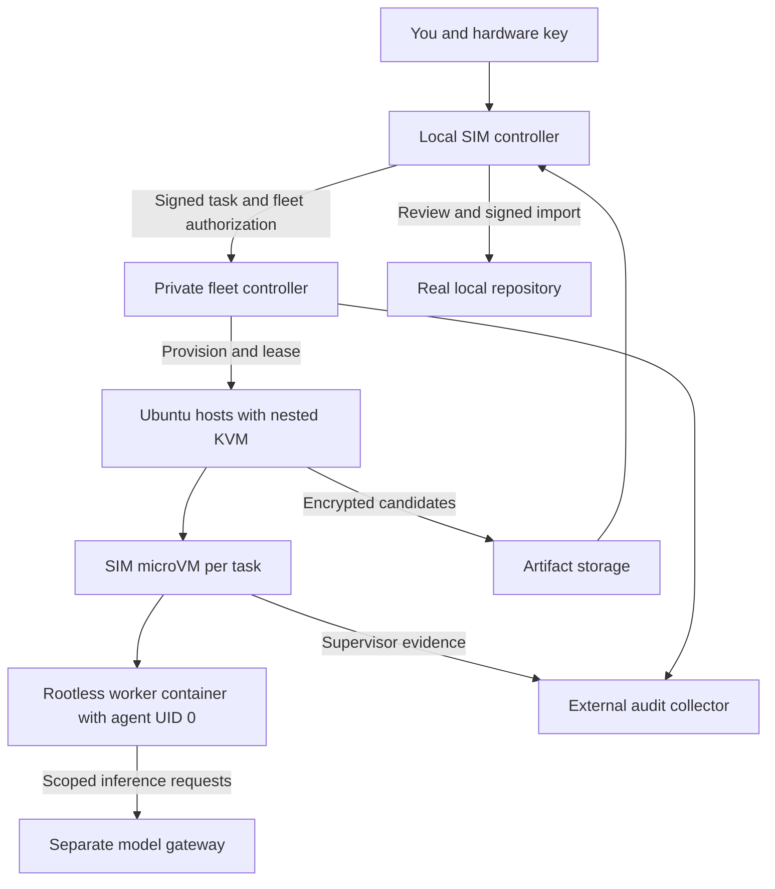

# SIM Remote Agent Fleet

Approved design source: https://chatgpt.com/space/page_dcc788ddc29c8191a64c2e3d98a3f9d7

The proposed setup runs SIM sandboxes on private Ubuntu hosts in your own GCP project. Your Mac remains the hardware trust root and owns the real source repositories. A small remote fleet controller keeps jobs running after the laptop disconnects and creates or removes compute hosts as demand changes.

Start with GCP Compute Engine N2 Intel hosts, Docker `sbx` as the runtime, IAP and OS Login for terminal access, attached service accounts for cloud access, and a separate model gateway. Keep SIM's existing signed image lineage and GCP authority with R2 and B2 replicas.

This is an architectural proposal, not an installed environment. The remote fleet commands and service interfaces below are proposed additions to SIM. Current provider account quotas, billing, hardware-key enrollment, Docker authentication, and real Linux sandbox behavior must pass the acceptance tests before a production deployment.

Assume hosted model inference through Claude and OpenAI. The machines run agent CLIs, tools, browsers, tests, and nested microVMs; they do not run the Claude or OpenAI model weights.

# Requirements and decisions

| Requirement | Proposed decision |
| --- | --- |
| Your own remote servers | Compute Engine VMs in your project, with root control and private addresses |
| Nested microVMs | Intel N2 host with nested virtualization enabled, running Ubuntu 24.04 LTS and sbx |
| Agent privileges | UID 0 inside a container launched by an unprivileged runtime inside each microVM |
| Terminal provisioning | Reviewed OpenTofu modules, immutable host images, and SIM fleet commands |
| Hardware-backed access | OS Login security keys plus IAP; SIM FIDO transaction signatures remain separate |
| No permanent cloud access keys | Human login, attached service accounts, and GitHub OIDC federation |
| 200 concurrent agents | Admission-controlled placement across multiple hosts, one microVM per task |
| Runs survive laptop disconnect | Remote controller persists jobs and leases |
| Code stays outside agent authority | Copy source without real .git; return candidates through local review and signed import |
| Independent observability | Stream supervisor evidence to an external collector and retained storage |
| Cost control | Maximum hosts, runtime, spend authorization, idle drain, and a separate resource reaper |

# Existing SIM integration

Reviewed [susanbeasles/sim](https://github.com/susanbeasles/sim) at main commit `0a3714ae0c1456dffabd9b6432879c31d92c832e`.

The [README](https://github.com/susanbeasles/sim/blob/0a3714ae0c1456dffabd9b6432879c31d92c832e/README.md), [architecture](https://github.com/susanbeasles/sim/blob/0a3714ae0c1456dffabd9b6432879c31d92c832e/docs/ARCHITECTURE.md), and [security model](https://github.com/susanbeasles/sim/blob/0a3714ae0c1456dffabd9b6432879c31d92c832e/SECURITY.md) establish copied source, synthetic Git, mountless sandboxes, FIDO signatures for protected transactions, PIV key unwrap, encrypted stakes, and a supervisor outside the worker namespace. Preserve these boundaries.

The integration gaps are concrete:

| Existing component | Required remote extension |
| --- | --- |
| SBXClient.swift executes a local sbx executable | Add a typed runtime interface and authenticated remote operations; retain the local implementation |
| WorkspaceService owns local workspace state and an active selection | Introduce task IDs, host IDs, independent leases, and explicit workspace selection for fleet operations |
| Package.swift targets macOS; VaultCrypto uses Security.framework | Keep the Mac signer and PIV path local; create a separate Linux host service |
| TrustGate verifies the Mac application on macOS | Establish Linux host image and service provenance independently; a successful Linux compile is not equivalent trust |
| GuestBootstrap writes local PTY and strace files | Stream evidence during the session, bound spool size, and finalize external receipts |
| Vault transport is planned but unwired | Implement authenticated ciphertext transport and signed authority without letting bucket listings select truth |
| Stake manifest lacks an explicit execution compatibility contract | Version the schema for architecture, runtime version, and image format; preserve verification of old records |

The repository excludes AWS/S3 from its existing vault topology. GCP compute preserves that design. An AWS compute adapter would be an optional extension, not an implicit change to the vault authority.

# Hosting choices

| Choice | Strength | Tradeoff | Use |
| --- | --- | --- | --- |
| GCP Compute Engine Intel N2 | Native nested KVM, IAM, IAP, OS Login security keys, attached identities; matches the vault authority | Continuous large fleets become expensive | Recommended initial elastic fleet |
| AWS EC2 Intel M8i or R8i | Nested KVM on supported virtual instances, temporary role credentials, Systems Manager access | Adds a provider and a second identity policy surface | Alternative if AWS identity and operations are preferable |
| Hetzner dedicated bare metal | Strong sustained-compute economics and direct hardware virtualization | Provisioning and billing are less elastic; provider API access is not the same native federation workflow | Later fixed-capacity pool for sustained usage |

Hetzner Cloud explicitly does not support nested virtualization. Its dedicated servers are a different product. MicroVMs directly on bare metal are ordinary hardware virtualization; microVMs inside a cloud VM require nested virtualization.

GCP documents Linux KVM support and warns that nested workloads can lose 10 percent or more performance. N2 is a conservative initial Intel choice; validate the selected zone and instance template rather than substituting E2, N2D, or an Arm machine.

AWS now documents nested virtualization on regular supported Intel EC2 instances. Use the regional instance-type feature query and confirm the chosen instance rather than relying on an old claim that EC2 requires bare metal.

Sources: [GCP nested virtualization](https://docs.cloud.google.com/compute/docs/instances/nested-virtualization/overview), [GCP N2 machine specifications](https://docs.cloud.google.com/compute/docs/general-purpose-machines#n2_machine_types), [AWS nested virtualization](https://docs.aws.amazon.com/AWSEC2/latest/UserGuide/amazon-ec2-nested-virtualization.html), [Hetzner Cloud FAQ](https://docs.hetzner.com/cloud/servers/faq/), [Hetzner dedicated virtualization](https://docs.hetzner.com/managed/managed-server/managed-vs-bare-metal-server/).

# System boundaries



Use one small private controller VM with an attached persistent state disk and transactional SQLite for the initial fleet. One controller process owns scheduling and allocation. Back up its database and reconcile provider resources by fleet labels after recovery. This has a single-controller availability limit, but keeps the first version manageable without Kubernetes or a distributed scheduler.

Use a separate small model gateway and audit collector so worker hosts have neither fleet-provisioning authority nor authority to erase retained evidence. They can share a separate trusted services VM initially with distinct OS users and service interfaces; neither runs on an agent execution host.

Keep the authoritative signed vault catalog in the existing GCP topology. Ordinary scheduler state is operational state, not a new source of cryptographic authority. Encrypted backups and candidates go to the configured artifact stores. R2, B2, and Dropbox remain transport and replication roles already defined by SIM.

Hosts receive immutable images containing pinned sbx, a host service, audit tools, and guest prerequisites. Use Node 24 LTS or a later supported LTS explicitly qualified by the project. Pin exact versions and digests in the release manifest. Install dependencies from reviewed, verified packages during the image build; do not execute repository-provided bootstrap instructions as host root.

One task gets one microVM. Inside that microVM, an unprivileged guest account runs a rootless OCI container runtime, and the agent runs as UID 0 inside its container. Container UID 0 maps to that unprivileged guest account; remaining container UIDs and GIDs use a task-specific subordinate ID range. The agent can install packages and administer its container filesystem within the assigned namespace capabilities. Guest root remains outside the worker container for supervision. Additional workers may share a VM only when explicitly assigned the same trust boundary. Builds run within this rootless boundary; do not add a virtualized Docker Desktop layer.

# Identity and authorization

## Human access

Use your Google account with enrolled hardware security keys. Authenticate the terminal through gcloud, use IAP to reach private hosts, and enable OS Login security keys on the controller and worker host templates. Google documents `enable-oslogin=TRUE`, `enable-oslogin-sk=TRUE`, and the `gcloud beta compute ssh` path for security-key SSH.

Account security-key enrollment and supported OpenSSH/libfido2 on the Mac are prerequisites. The OS Login key workflow is separate from SIM's existing OpenSSH FIDO signing key. Verify the actual enrolled key and recovery method rather than assuming a PIV identity is interchangeable.

OIDC proves identity; it does not by itself prove a hardware signature over each action. Keep SIM's FIDO signature over the exact canonical transaction when authorizing a stake, import, network-policy expansion, release, or fleet grant.

Sources: [OS Login security keys](https://docs.cloud.google.com/compute/docs/oslogin/security-keys), [IAP TCP forwarding](https://docs.cloud.google.com/iap/docs/using-tcp-forwarding).

## Cloud workloads and deployment

Attach distinct service accounts to the controller, workers, model gateway, and collector. Grant only the resource access each needs. Downloaded service-account JSON keys are unnecessary.

The controller can create hosts only from the approved templates and within a bounded fleet. Workers can fetch their assigned encrypted inputs and submit results, but cannot change IAM, host templates, fleet limits, or source authority. The gateway can invoke selected models and cannot provision hosts. The collector can append evidence and cannot delete retained objects.

Use GitHub Actions OIDC through GCP Workload Identity Federation for builds and deployment. Bind trust to your numeric repository and owner IDs, a protected deployment workflow and ref/environment, and the expected audience. Restrict who can modify the workflow. Federation is authentication, not a substitute for protecting the code that receives deployment authority.

Sources: [GCP Workload Identity Federation](https://docs.cloud.google.com/iam/docs/workload-identity-federation), [Deployment pipeline federation](https://docs.cloud.google.com/iam/docs/workload-identity-federation-with-deployment-pipelines).

## Fleet authorization

Extend the existing signed-transaction mechanism with a fleet grant containing the source and stake digests, allowed runtime and host-image digests, vendors and model allowlist, task limit, host limit, resource classes, permitted destinations, maximum runtime, cost authorization, expiry, recipient policy, and a one-time nonce.

The controller supplies a random challenge with a short validity window. The local application displays the concrete grant, signs its canonical bytes in a domain-separated SIM namespace, and submits it. The controller verifies the pinned public key, signature, audience, expiry, and unused nonce, then records the accepted grant durably. Consume the nonce atomically to prevent replay.

That grant allows autoscaling within its limits without a key touch for every VM. A request that expands authority needs a new signed grant. Existing protected Git imports remain individually signed.

Grant revocation blocks new work and model access immediately at the broker. Hardware signing does not make subsequently issued bearer tokens theft-proof; bind gateway sessions to the host connection and task identity and keep their lifetimes short.

# Hardware keys and remote image restore

Keep both private hardware keys on your Mac. Never forward your SSH agent, PIV token, USB device, account refresh token, or personal cloud profile to an execution host.

A remote host must eventually hold plaintext executable image bytes to run the guest. Hardware-gated encryption protects stored artifacts and authorization; it does not conceal a running guest from the host root or cloud provider.

Remote restore needs an explicit addition to the current PIV-only restore flow:

1. Verify the original signed stake and parent chain locally, including artifact digests and runtime compatibility.

2. PIV-unwrap the image data key locally.

3. Authorize a bounded fleet session and establish a separate session envelope for key delivery.

4. Deliver the key over an authenticated encrypted channel to an approved host recipient, or temporarily delegate it to the key broker for that fleet session.

5. Each host verifies artifact digests, decrypts, verifies plaintext, loads the template, and removes staging files.

6. End the grant, remove plaintext templates according to retention policy, and destroy the session envelopes and broker memory keys.

Do not rewrite the original signed keyWrap or pretend the existing manifest already authorizes new recipients. The session envelope references the original stake digest, host recipient public key, fleet grant, expiry, and session ID.

For automatic new hosts while your laptop is disconnected, choose bounded delegation: the key broker may keep the approved data key in RAM during an authorized session and wrap it to newly enrolled host keys. That makes the broker an additional trusted plaintext boundary. It must reject hosts outside the approved project, template and fleet policy. A broker restart loses the key and requires a fresh hardware unlock.

Without this delegation, already unlocked hosts can continue running, but a new host cannot independently decrypt a PIV-only image while your key is offline. This is a real tradeoff between unattended scaling and hardware presence.

Cloud identity and image-provenance checks authenticate an expected host deployment; they are not hardware remote attestation. Do not claim confidential computing or resistance to a compromised host root.

# Model authentication

Put provider authentication in the separate gateway, outside the worker VMs. Give each task a short-lived, bounded inference capability tied to its host channel, vendor, model, expiry, token budget, and spend allocation. The task gets no general Google API access.

For Claude, use Claude Code's GCP integration through Vertex AI, currently described in Anthropic's documentation as Google Cloud's Agent Platform. The trusted gateway uses an attached identity and provider-native authentication. Preserve native request and streaming behavior, and test tools, token counting, prompt caching, errors, and cancellation. If direct Anthropic endpoints are required for specific features, support a separate backend with its credential held only at the gateway.

For OpenAI API access, prefer documented workload identity federation from the gateway's GCP service account to an OpenAI Platform service account. Google metadata supplies an OIDC identity token; OpenAI exchanges it for a temporary access token. This requires the relevant Platform provider and mapping to be configured.

Codex's native workload identity federation for ChatGPT workspace entitlements is a separate beta for managed workspaces and must be enabled. Do not assume a personal Pro subscription includes it. The default unattended fleet path should be API-billed Codex behind a compatible gateway. If API federation is unavailable for the account, a narrowly scoped provider API key stored only in the gateway is a clearly identified fallback, not a credentialless end state.

Interactive subscription login can be supported as a separate session mode if the provider supports the intended use. It does not establish a 200-agent concurrency or unlimited-usage entitlement.

The gateway must preserve the actual Codex Responses API protocol and Claude API protocol. A generic chat-completions proxy is insufficient. Keep control-plane records content-light; prompts and responses contain source code and must have an explicit encrypted retention policy.

Sources: [Claude GCP integration](https://code.claude.com/docs/en/google-vertex-ai), [Claude gateway configuration](https://docs.anthropic.com/en/docs/claude-code/llm-gateway), [OpenAI workload identity federation](https://developers.openai.com/api/docs/guides/workload-identity-federation), [OpenAI GCP federation](https://developers.openai.com/api/docs/guides/workload-identity-federation/google-cloud), [Codex authentication](https://learn.chatgpt.com/docs/auth).

# Runtime and network controls

Docker documents headless Ubuntu 24.04 or later with KVM for local sbx sandboxes. In this design, a sandbox is local to your remote host; it is not a Docker-managed cloud sandbox.

Docker also requires account sign-in. On headless Linux, sbx may store secrets in a file protected by filesystem permissions when no Secret Service exists. Keep provider master credentials out of that store, out of golden images, and out of stakes. Qualify noninteractive host enrollment and refresh before promising unattended scale-out; manual login on every newly created host fails the acceptance criteria.

If Docker authentication cannot support the required fleet lifecycle acceptably, implement a separate direct-KVM runtime backend, such as Firecracker. That is substantial runtime work and requires new image tooling and conformance tests. Existing sbx template archives are not automatically Firecracker boot images. Preserve the runtime interface so this is an explicit implementation choice.

Use host-enforced default-deny egress. Agents can reach the model gateway, approved package sources, and explicitly approved services. Deny cloud metadata, loopback and host management endpoints, private networks, link-local addresses, other guests, and unauthorized DNS or arbitrary tunnels. Enforce equivalent controls for IPv4 and IPv6, including traffic routed through host-side proxies. Reject unsafe destination resolution and redirects, and revalidate resolved addresses to resist DNS rebinding.

Keep management traffic on a distinct path. Hosts have no public IPs; IAP access is authorized by IAM, and its firewall allowance is scoped to management targets. Configure private Google API access and explicit outbound NAT/proxy service where needed. Default VPC east-west rules must not expose other hosts to guests.

The agent runs as container root while the enclosing container runtime runs as an unprivileged guest user. Use separate user, mount, PID, IPC, and network namespaces with task-specific UID/GID mappings and explicit resource limits. Container capabilities apply within its user namespace; the agent receives no guest-root or outer-host privilege. The agent has no outer host or guest management runtime socket, KVM device, host filesystem mount, or privileged management API. An optional build daemon or socket must be scoped to the task's own rootless environment. The host service accepts typed create, exec, copy, inspect, and delete requests bound to task IDs; it does not offer an arbitrary host shell. Human root access is an explicit audited maintenance path.

Sources: [Docker installation](https://docs.docker.com/ai/sandboxes/install/), [Docker headless behavior and login](https://docs.docker.com/ai/sandboxes/faq/), [Docker mountless sandbox](https://docs.docker.com/ai/sandboxes/agents/shell/).

# Capacity for 200 agents

Use `n2-standard-32` initially: 32 vCPUs and 128 GB reported memory. A vCPU is a hardware thread, not a dedicated physical core. Convert resource units consistently in admission calculations.

The following are planning targets, not measured SIM density:

| Agent workload | Guest allocation | Initial slots per host | Hosts for 200 | Main limit |
| --- | --- | --- | --- | --- |
| Light CLI and model waiting | 1 vCPU and 2 GiB | 50 | 4 | Memory, VMM overhead, CPU bursts |
| Normal development with tests | 2 vCPU and 4 GiB | 25 | 8 | CPU contention and dependencies |
| Browser or heavier build | 4 vCPU and 8 GiB | 12 | 17 | CPU and I/O |

Fifty light guests reserve 100 GiB for guests and leave roughly 28 GiB for the host, runtime, logging, caches, and safety margin before unit conversion. Their assigned 50 vCPUs share 32 host vCPUs. That is intentional oversubscription for work that waits frequently. It is unsuitable as a promise that fifty CPU-saturated jobs receive dedicated cores.

Count a warm VM as consuming resources. Enforce per-task CPU quotas and memory, PID, filesystem, output, runtime, and audit-spool limits. Increase density only after measuring the real workload with full audit enabled. Reserve disk for actual sbx template duplication behavior; do not assume copy-on-write storage savings until measured.

Start with four light hosts available at peak, a maximum of ten hosts in the initial signed policy, and zero idle worker hosts. Normal development can use eight hosts for 200 tasks. A 200-heavy-task request requires a larger grant and quota; otherwise it queues visibly.

One larger N2 host can provide the same aggregate resource envelope, but it concentrates failure and leaves fewer placement choices. Prefer multiple hosts for this target unless benchmarks establish a clear reason to consolidate.

Request sufficient regional N2 CPU quota for the approved peak, plus separate ordinary VM quota for trusted services. Confirm regional capacity, storage, outbound NAT connection capacity, and provider rate limits. Compute capacity and model throughput are separate admission constraints.

Source: [GCP machine specifications](https://docs.cloud.google.com/compute/docs/general-purpose-machines#n2_machine_types).

# Scheduling and persistence

Persist a task before dispatch. Track source digest, image digest, guest architecture, vendor, task budget, requested resources, host assignment, lease generation, and candidate result digest.

Hosts register through their cloud identity and an ephemeral connection key. A host becomes ready only after runtime, policy, disk, audit, image, Docker authentication, and model-path checks pass. Dispatch is idempotent by task ID and lease generation.

The scheduler maintains both workspace concurrency and inference quotas. It can keep 200 agents alive while limiting concurrent model calls to the provider quota. Apply token and request-rate limits, jittered backoff, and fair queues so repeated throttling does not create a retry storm.

Autoscaling uses pending resource demand and observed pressure. Include provisioning hosts in desired capacity. A scale-down candidate first stops accepting new tasks, finishes or explicitly checkpoints its work, uploads encrypted candidates, receives audit acknowledgments, and then becomes deletable. Do not hand ordinary CPU-based autoscaling authority to terminate active workspaces.

Set an initial ten-minute idle grace period. Burst cold starts include cloud provisioning, Docker authentication, image fetch, decrypt/load, and guest bootstrap. Warm hosts trade ongoing cost for faster startup; do not promise Codespaces-style startup latency without measuring these steps.

A lost host expires its leases. Retry only tasks whose side effects are controlled or explicitly retryable; maintain idempotency keys for external actions. Existing tasks may continue during a short controller outage under an unexpired grant, but new authority fails closed. Reconcile labeled resources and leases after restart.

Store durable outputs as encrypted candidate bundles with task and baseline identity, path manifest, hashes, and exit status. Local SIM validates path traversal, symlinks, size limits, and file types before review. Preserve BASE/OURS/THEIRS semantics and sign the exact import transaction. Remote agents never receive credentials that can push directly to protected source branches.

Generic persistence uses encrypted workspace/template exports. Do not promise cross-host live migration or restoration of a running process from an ordinary filesystem template.

# Audit and emergency controls

Extend GuestBootstrap's real-root supervisor and the host control ledger. The supervisor runs as guest root outside the rootless worker container, with its evidence files, process handles, and upload authority excluded from the container's mounts and namespaces. Adapt process tracing to the actual OCI launch path and verify coverage across child processes and nested namespaces. Send process execution, PTY evidence, lifecycle events, policy changes, network decisions, model usage, and output digests to the external collector during execution.

Correlate evidence by fleet, grant, task, workspace, host, lease generation, session, and sequence. Hash-chain events, encrypt sensitive payloads, and periodically anchor signed collector receipts in retained storage. A host may append its stream but cannot delete or rewrite an acknowledged segment.

PTY and syscall evidence does not prove the semantic identity of every vendor tool or decrypt every MCP/API request. Add structured harness events where available, and retain the distinction between those reports and independently observed process/network evidence.

Set finite log and trace quotas. Full strace at 200 agents can consume substantial CPU, disk, and bandwidth. Use an encrypted bounded spool, monitor lag, and stop new work if the collector is unavailable. A short grace window for running work must be explicit; audit loss must never silently become unaudited execution. Keep secrets out of authentication commands captured in PTYs and encrypt any raw evidence that can contain tokens or source.

Implement three separate controls: pause dispatch, revoke model access, and stop guest execution. A control-plane emergency stop invalidates task capabilities and destroys or stops affected guests through the host service; a separately authorized provider reaper removes expired fleet resources even when the scheduler is broken. The agent role cannot change the reaper.

# Terminal deployment and daily use

The real provider commands below illustrate the required mechanics. They depend on an existing project, configured billing and APIs, appropriate IAM, enrolled keys, the named private subnet, and the host service account. A stock Ubuntu VM created here is a preflight host, not the finished fleet image.

```bash
gcloud auth login

gcloud compute instances create sim-kvm-preflight \
  --project=YOUR_PROJECT_ID \
  --zone=us-central1-a \
  --machine-type=n2-standard-32 \
  --image-family=ubuntu-2404-lts-amd64 \
  --image-project=ubuntu-os-cloud \
  --subnet=sim-workers \
  --no-address \
  --service-account=sim-worker@YOUR_PROJECT_ID.iam.gserviceaccount.com \
  --scopes=cloud-platform \
  --enable-nested-virtualization \
  --metadata=enable-oslogin=TRUE,enable-oslogin-sk=TRUE

gcloud beta compute ssh sim-kvm-preflight \
  --project=YOUR_PROJECT_ID \
  --zone=us-central1-a \
  --tunnel-through-iap
```

The broad OAuth scope above delegates API authorization to the deliberately narrow service-account IAM policy; it is not a grant of broad IAM roles. Provision IAP firewall access and outbound networking through infrastructure code before this command.

After host access, verify `/dev/kvm`, load the appropriate KVM module, check nested virtualization, then boot an actual sbx microVM. A CPU flag or device node alone is insufficient. Confirm unprivileged user namespaces and full-audit prerequisites inside the guest.

The proposed SIM interface is:

```bash
# Proposed commands; these do not exist in the reviewed SIM revision.
sim fleet plan --config fleet.yaml
sim fleet apply --plan fleet-plan.json
sim fleet authorize --max-agents 200 --max-hosts 10 --ttl 4h
sim remote create --repo sim --vendor codex --count 200 --profile light
sim remote attach TASK_ID
sim remote logs TASK_ID --follow
sim remote diff TASK_ID
sim remote fetch TASK_ID
sim git merge
sim fleet drain --idle
sim fleet down
```

The signing operation must display the complete limits and estimated cost of the exact plan. An unattended request may consume only an already signed grant.

Keep the fleet policy outside agent-writeable repositories and guest mounts. Its proposed configuration shape is:

```yaml
schema: sim-fleet/v1
provider: gcp
region: us-central1
zones: [us-central1-a, us-central1-b]
host:
  machineType: n2-standard-32
  architecture: amd64
  nestedVirtualization: true
  imageSource: signed-release-manifest
  publicAddress: false
capacity:
  minHosts: 0
  maxHosts: 10
  maxAgents: 200
  idleGraceSeconds: 600
defaults:
  profile: light
  vendor: codex
  grantLifetimeSeconds: 14400
security:
  osLoginSecurityKeys: true
  metadataFromGuest: deny
  agentHostMounts: deny
  auditRequired: true
  sourceImport: local-hardware-signature
```

This schema is a design contract; it is not an existing sbx or SIM configuration file. Deployment must resolve immutable host and guest digests from the signed release and reject an absent cost policy before creating billable resources.

OpenTofu should provision project services, network and NAT, IAM and federation, IAP rules, private trusted services, disks, retained audit and artifact storage, and host templates. SIM owns scheduling and per-task leases. Avoid two independent autoscalers managing the same host pool.

# Cost model

Use hourly demand rather than treating the maximum fleet as always-on capacity.

Total cost is host compute hours plus attached disks, trusted services, NAT, artifact storage, egress, logs, and model inference. Worker compute can scale to zero; trusted services and retained storage still cost money.

For illustration only, assume a worker costs 2 USD per host-hour in compute. This is an arithmetic assumption, not a verified current GCP quote:

| Light fleet usage | Worker compute under that assumption |
| --- | --- |
| Four hosts for eight hours | 64 USD |
| Four hosts for forty hours per month | 320 USD per month |
| Four hosts continuously for 730 hours | 5840 USD per month |
| Eight standard-workload hosts continuously for 730 hours | 11680 USD per month |

Fetch a dated regional price estimate for the exact machine, disks, NAT, and logging policy before apply. Include image download and audit costs, and show the cost of idle retained disks. Cloud budget alerts are not hard spending caps. Enforce admission limits, expirations, and a reaper as operational controls; even those cannot guarantee a perfectly exact billing cutoff.

If actual usage is hundreds of active agents around the clock, evaluate a dedicated bare-metal pool with the same SIM runtime and identity boundaries. It trades elasticity for cost predictability. Keep that as a separate provider adapter after measuring usage, rather than funding an always-on hyperscaler maximum by accident.

Reference: [GCP compute pricing](https://cloud.google.com/products/compute/pricing).

# Deliverables and acceptance

| Deliverable | Completion criterion |
| --- | --- |
| Infrastructure modules | A fresh project can be provisioned and removed from the terminal with a reviewable plan |
| Signed host image | Immutable Ubuntu image pins the runtime and host service and passes provenance verification |
| Remote runtime protocol | Create, exec, copy, inspect, and remove are authenticated, scoped, idempotent, and versioned |
| Local hardware authority | Existing stake, PIV, and exact Git import signing continue to work; fleet grants prevent replay |
| Remote key release | Approved recipient delivery works; expired grants, wrong hosts, and altered artifacts fail |
| Fleet scheduler | Tasks survive laptop disconnect; lease recovery and draining do not lose accepted results |
| Model gateway | Both CLIs support interactive and unattended runs with streaming and enforced task budgets |
| Independent audit | External retained receipts survive guest reset and attempted local deletion |
| Operating guide | Bootstrap, recovery, pause, revoke, drain, teardown, and cost estimation are documented |

Validate in this order: one real nested microVM; two isolated tasks; twenty mixed tasks; fifty guests on one host; then two hundred across the fleet with full audit enabled. Report boot time, task latency, peak RAM, CPU pressure, disk growth, trace volume, network failures, provider throttles, and cost.

The 200-task gate requires all accepted tasks to launch or complete according to their declared resource profile, with no silent OOM or missing audit receipts. It does not require 200 simultaneous model requests when the provider quota is lower.

Exercise hostile or broken inputs: a replayed nonce, wrong issuer/audience, expired grant, changed image digest, stale catalog head, incompatible architecture, poisoned same-name template, metadata access, peer-guest access, runtime-socket access, unauthorized source import, full disk, collector outage, host loss, and controller restart. Verify that new work cannot acquire additional authority through any of these paths. Verify that the agent sees UID 0 inside its container while the guest observes an unprivileged mapped UID. Test package installation, subordinate UID/GID isolation, resource limits, rootless build behavior, and supervisor tracing. Attempts to modify the guest root filesystem, inspect supervisor processes, change audit evidence, acquire a management socket, or expand privileges outside the user namespace must fail.

Two dependencies must be settled before treating the system as fully unattended: Docker's approved noninteractive authentication lifecycle on freshly created hosts, and the actual OpenAI account's federation availability. Fail these gates visibly rather than masking them with permanent credentials in images.

The recommended first implementation is one GCP region, two eligible zones, one Mac authority, one private controller, a separate trusted gateway/collector service, and an elastic sbx worker pool. Preserve the existing SIM trust boundaries while adding the remote control layer.
